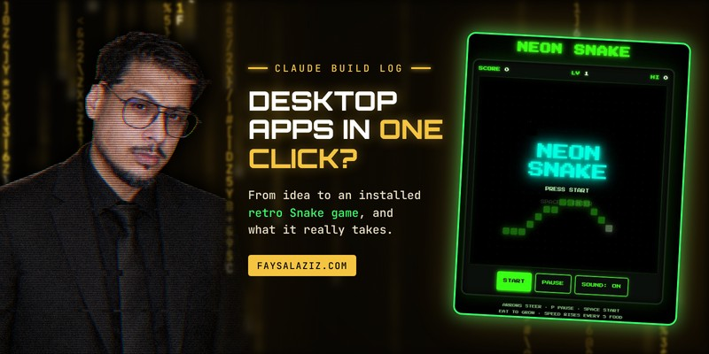
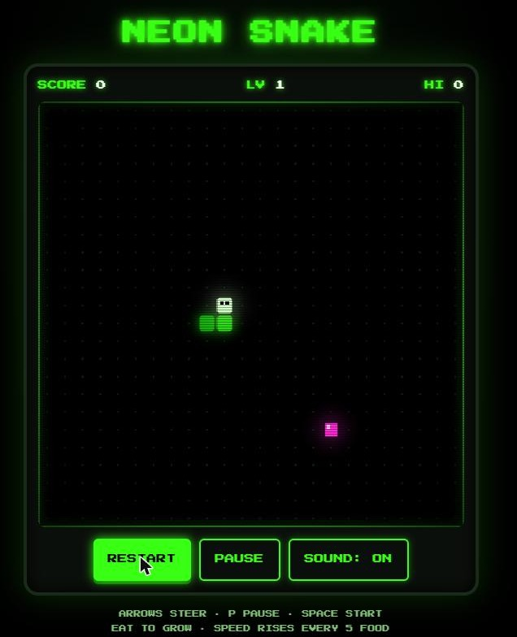
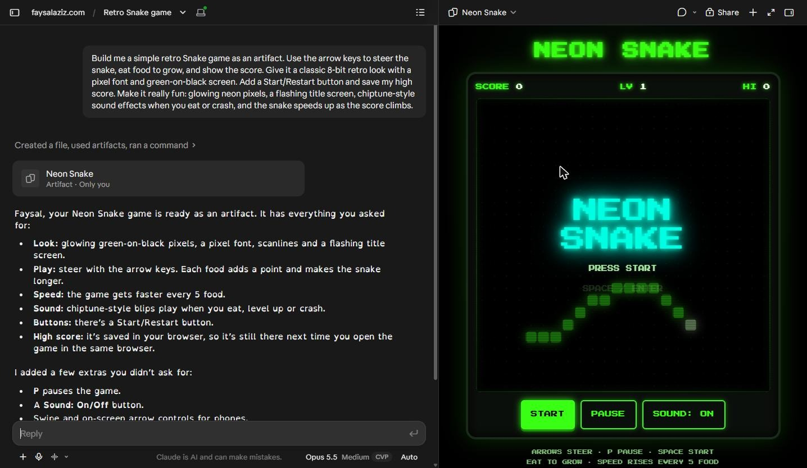
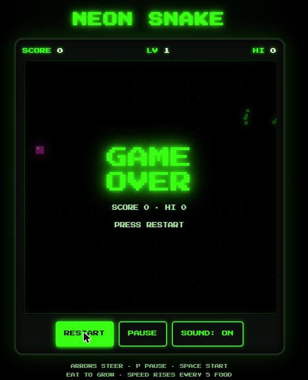

# Neon Snake: a desktop app built with Claude

A retro, neon Snake game built entirely by describing it to Claude in plain English, then tried as a Claude artifact and installed as a desktop app.

It is the example from my article **[Desktop Apps "in One Click" with Claude: What It Really Takes](https://faysalaziz.com/latest/claude-desktop-apps-one-click-what-it-really-takes/)**.

## Play it

No install, no build step. It is one HTML file.

1. Download `index.html` from this repository.
2. Double-click it to open it in your browser.
3. Click **Start** (or press Space) and steer with the arrow keys.

## Controls

- **Arrow keys:** steer the snake
- **Space or Enter:** start, or pause and resume
- **P:** pause
- **Sound: On/Off button:** mute the chiptune sound effects
- **Phones:** swipe on the screen, or use the on-screen arrows

Each food adds a point and makes the snake longer. The game speeds up every 5 food. Your high score is saved in your browser.

## The prompt that built it

This is the exact request I typed into Claude:

> Build me a simple retro Snake game as an artifact. Use the arrow keys to steer the snake, eat food to grow, and show the score. Give it a classic 8-bit retro look with a pixel font and green-on-black screen. Add a Start/Restart button and save my high score. Make it really fun: glowing neon pixels, a flashing title screen, chiptune-style sound effects when you eat or crash, and the snake speeds up as the score climbs.

Claude added a few extras on its own: P to pause, a sound toggle and swipe controls for phones.

## Make it a desktop app

In the Claude desktop app for Mac or Windows, open the artifact, open the **Share** menu and choose **Install as app**. The option is not in Claude on the web. See Anthropic's guide: [Install as app](https://claude.com/resources/articles/install-as-app).

## One click is the last click

"One click" is an exaggeration. This game is a fun example of what is possible. To build an app properly and professionally, use spec-based development: write down what the app must do first, then build against that spec. I explain how in [Spec-Based Development with AI Agents: A Step-by-Step Tutorial](https://faysalaziz.com/latest/spec-based-development-with-ai-agents-a-step-by-step-tutorial/).

## Screenshots

| Built as an artifact | Game over |
| --- | --- |
|  |  |

## Credits

- Game code generated by Claude (Anthropic) from the prompt above.
- Font: [Press Start 2P](https://fonts.google.com/specimen/Press+Start+2P), loaded from Google Fonts.
- Author: [Faysal Aziz](https://faysalaziz.com)

## License

MIT. See [LICENSE](LICENSE).
